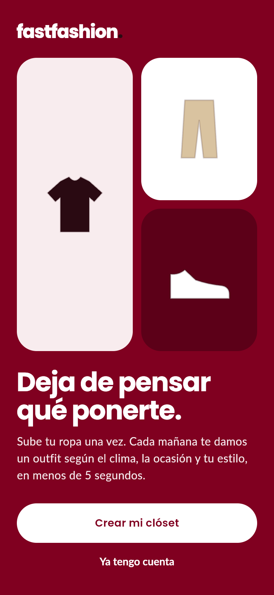
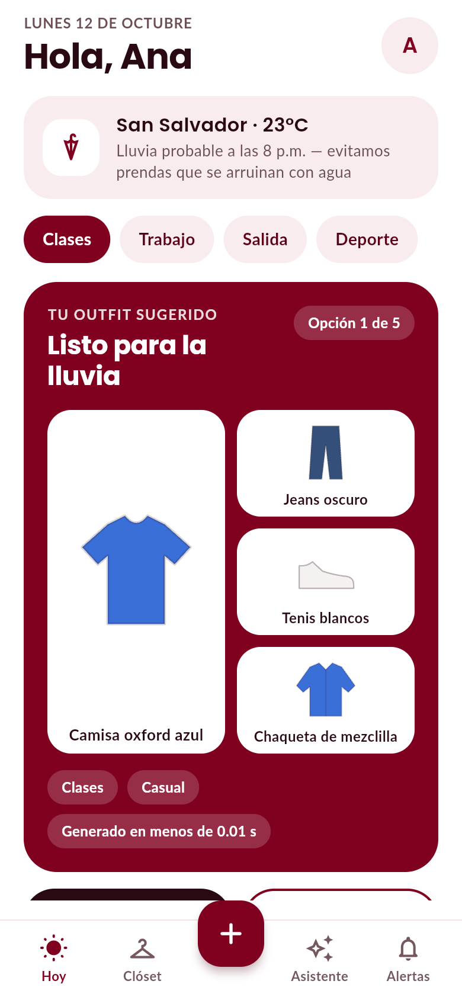
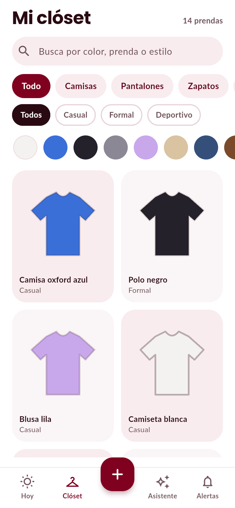
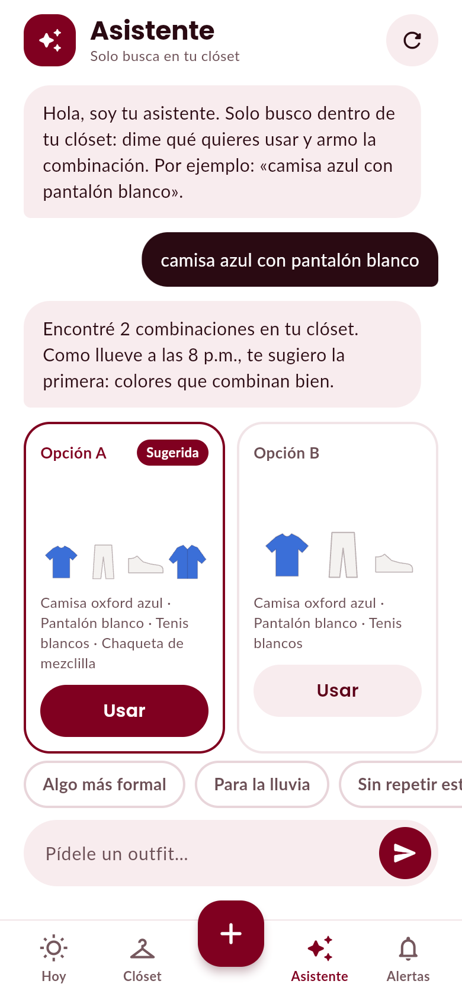
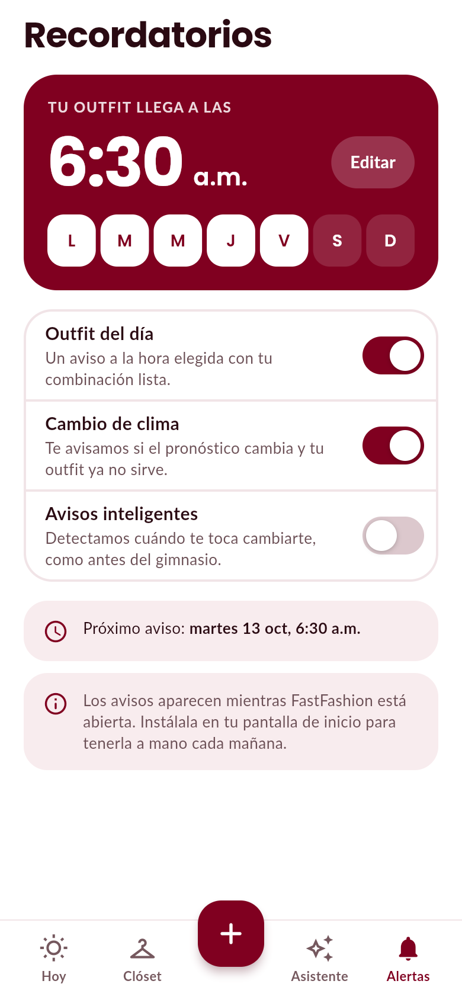

# FastFashion

> Tu outfit en segundos, con lo que ya tienes en tu clóset.

App web móvil en **Flutter** (responsiva, instalable como PWA) que arma el outfit del día
según el **clima real**, la **ocasión**, el **estilo** y lo que ya usaste esta semana.
Funciona de inmediato con una **base de datos local persistente** y se conecta a **Supabase**
cambiando una variable de compilación, sin tocar el código.

<p align="center">
  
  
  
  
  
</p>

## Pantallas

| # | Pantalla | Qué hace |
|---|----------|----------|
| 01 | **Bienvenida** | Propuesta de valor y acceso. |
| — | **Iniciar sesión / Crear cuenta** | Formularios validados; atajo a la cuenta demo. |
| 02 | **Hoy** | Clima real, selector de ocasión, outfit del día con motivos, «Otra opción», «Usar este outfit», avisos de clima. |
| 03 | **Mi clóset** | Búsqueda sin acentos + filtros por categoría, estilo y color; cuadrícula responsiva. |
| — | **Detalle de prenda** | Editar, ver usos, cambiar foto, eliminar con confirmación. |
| 04 | **Agregar prenda** | Cámara/galería, detección del color dominante de la foto, nombre automático. |
| 05 | **Asistente** | Conversación en español que **solo busca en tu clóset** (Opción A/B, «Usar»). |
| 06 | **Recordatorios** | Hora, días y 3 tipos de aviso; próximo aviso calculado. |
| — | **Perfil** | Nombre, ciudad (para el clima), prendas de ejemplo, cerrar sesión. |

## Probarlo ahora

```bash
flutter pub get
flutter run -d chrome          # base local (demo)
```

Cuenta demo (solo con base local): **ana@fastfashion.app** · **fastfashion**
— o pulsa *«Entrar con la cuenta demo»*.

## Conectar Supabase

La app habla con la base mediante la interfaz `DatabaseClient`; hay dos implementaciones
intercambiables (`LocalDatabase` y `SupabaseDatabaseClient`).

1. Crea un proyecto en [supabase.com](https://supabase.com) y ejecuta [`supabase/schema.sql`](supabase/schema.sql)
   en el *SQL Editor* (tablas, trigger de perfil, **RLS** y bucket de fotos).
2. Compila con tus credenciales (la *anon/publishable key* es pública por diseño; la seguridad la da RLS):

```bash
flutter run -d chrome \
  --dart-define=BACKEND=supabase \
  --dart-define=SUPABASE_URL=https://xxxx.supabase.co \
  --dart-define=SUPABASE_ANON_KEY=eyJ...
```

Si falta una credencial o Supabase no responde, la app **cae a la base local** en vez de quedarse en blanco.

## Despliegue (GitHub Pages)

`.github/workflows/deploy-web.yml` compila y publica en cada push a `main`.

1. En el repo: **Settings → Pages → Build and deployment → Source: _GitHub Actions_**.
2. (Opcional, para Supabase) en **Settings → Secrets and variables → Actions** crea la variable
   `BACKEND=supabase` y los secretos `SUPABASE_URL` y `SUPABASE_ANON_KEY`.
3. Haz push a `main` (o ejecuta el workflow a mano). URL: `https://<usuario>.github.io/fastfashion/`.

## Calidad

```bash
dart format --set-exit-if-changed lib test
flutter analyze --fatal-infos
flutter test                    # 160+ pruebas
```

Las pruebas de pantalla corren a **320, 360, 390 y 430 px** con texto del sistema al **140 %**
(fallan ante cualquier `RenderFlex overflow`), y hay pruebas de flujo de la app completa de 320 a 1280 px.

## Flujo de ramas (GitFlow)

```
main ────────────────●───────────────●──  producción (despliega a Pages)
                    ╱               ╱
develop ───●───●───●───●───●───●───●────  integración
            ╲ ╱     ╲ ╱
 feature/*   ●        ●                   una por funcionalidad, vía Pull Request
```

`main` → solo releases · `develop` → integración · `feature/*`, `fix/*`, `chore/*`, `ci/*`, `docs/*` → trabajo.
Detalle de patrones y capas en [`docs/ARCHITECTURE.md`](docs/ARCHITECTURE.md).

## Alcance y límites conocidos

- **Avisos**: aparecen mientras la app está abierta (banner a la hora elegida). Notificaciones push con la
  pestaña cerrada requieren un servidor de push (FCM/Web Push) y quedan como siguiente paso.
- **Detección en la foto**: es **el color dominante** calculado en el dispositivo (sin red). La categoría la
  elige la persona; reconocer prendas con visión por computador es una mejora futura detrás de la misma interfaz.
- **Asistente**: motor determinista con léxico en español (colores, prendas, estilos, clima). Se puede sustituir
  por un LLM sin cambiar la UI; hoy no inventa prendas ni sale de tu clóset.
- **Cuentas locales**: se guardan con sal + SHA-256 en el navegador, suficiente para la demo; en producción
  usa Supabase Auth.
- Clima: [Open-Meteo](https://open-meteo.com) (gratuito, sin llave). Sin red se usa un clima típico y se avisa.

## Licencias

Tipografías Poppins y Lato bajo SIL OFL 1.1 (ver `assets/fonts/OFL-*.txt`).
